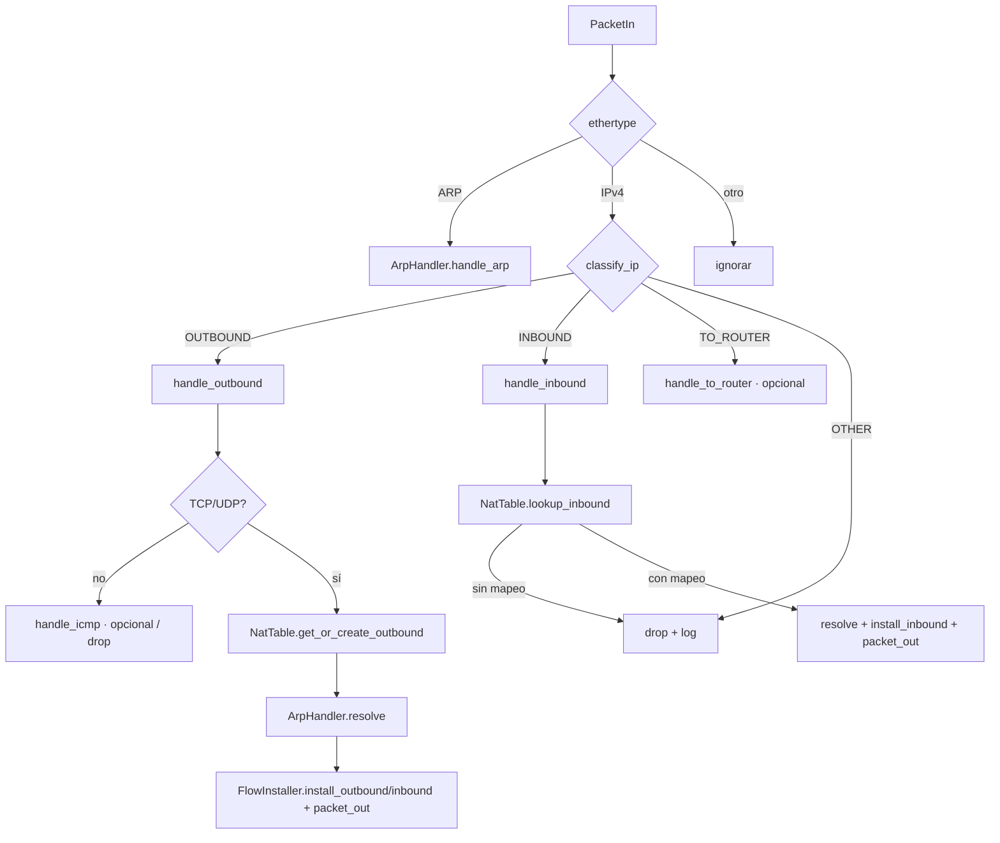

# Arquitectura y decisiones de diseño

Qué cumple cada parte del enunciado (`docs/enunciado_TP2_NAT.pdf`) y cómo lo resolvemos.
Los diagramas son Mermaid (GitHub los renderiza).

## 1. Idea central

El switch OpenFlow `s1` actúa como **router L3 con NAT saliente + PAT**. El controlador POX
solo interviene en **tres casos**: paquete de una conexión nueva, ARP, y expiración de estado.
Una vez resuelta la traducción de una conexión, **dos flujos OpenFlow exactos** (saliente y
entrante) hacen todo el trabajo en el switch.

```mermaid
flowchart LR
  subgraph Privada 192.168.1.0/24
    h2; h3; h4
  end
  subgraph s1[s1 = router + NAT]
    pp[puertos 2..N<br/>MAC bb:bb:bb · IP .254]
    pub[puerto 1<br/>MAC aa:aa:aa · IP 200.0.0.254]
  end
  subgraph Pública 200.0.0.0/24
    h1
  end
  h2 --- pp; h3 --- pp; h4 --- pp
  pub --- h1
  s1 <-. OpenFlow 1.0 .-> C[Controlador POX<br/>natsdn]
```

## 2. Componentes (paquete `natsdn/`)

| Módulo | Responsabilidad | Estado | Toca POX/switch |
|---|---|---|---|
| `config.py` | Lee `config/network.json`; helpers de subred; timeouts por protocolo | puro | no |
| `packet_utils.py` | Extraer L4 de un IPv4; construir ARP request/reply | puro | no |
| `arp_table.py` | Tabla ARP dinámica `IP → (MAC, puerto switch, TTL)` | puro | no |
| `port_pool.py` | Pool de puertos públicos por protocolo | puro | no |
| `nat_table.py` | Tabla NAT por conexión, índices saliente/entrante, ciclo de vida | puro | no |
| `switch_io.py` | `packet_out`, `flow_mod` add/delete (capa fina sobre `connection`) | I/O | sí |
| `flow_installer.py` | `NatEntry` → match + acciones OpenFlow; cookies; borrado | I/O | vía `SwitchIO` |
| `arp_handler.py` | Responder ARP del router; resolver MACs con cola de pendientes | I/O + estado | vía `SwitchIO` |
| `nat_router.py` | Orquestador: clasifica `PacketIn`, delega, atiende `FlowRemoved` | glue | sí |

Dependencias (flecha = “usa a”): `nat_router → arp_handler, nat_table, flow_installer, config`;
`arp_handler → arp_table, packet_utils, switch_io`; `flow_installer → switch_io, nat_table`;
`nat_table → port_pool`. Los módulos **puros** no importan nada de OpenFlow y se testean sin
Mininet (`tests/`).

## 3. Flujos

### 3.1 Primera conexión saliente (incluye ARP dinámico)

```mermaid
sequenceDiagram
  participant H2 as h2 (privado)
  participant S as s1 (switch)
  participant C as Controlador
  participant H1 as h1 (servidor público)
  H2->>S: ARP who-has 192.168.1.254
  S->>C: PacketIn (ARP)
  C->>C: aprende h2 (IP→MAC,puerto)
  C->>S: PacketOut ARP reply (MAC bb:bb:bb)
  H2->>S: TCP SYN 192.168.1.2:40000 → 200.0.0.1:80
  S->>C: PacketIn (sin flujo)
  C->>C: NatTable: asigna puerto público 49152
  C->>S: PacketOut ARP who-has 200.0.0.1 (por puerto 1)
  Note over C: el SYN queda en cola pendiente
  H1->>S: ARP reply
  S->>C: PacketIn (ARP)
  C->>C: aprende h1; completa la resolución pendiente
  C->>S: FlowMod saliente + FlowMod entrante (SEND_FLOW_REM)
  C->>S: PacketOut del SYN con las mismas acciones
  S->>H1: SYN 200.0.0.254:49152 → 200.0.0.1:80 (MAC aa:aa:aa → h1)
```

### 3.2 Resto de la conexión (sin controlador)

`h1 → 200.0.0.254:49152` coincide con el flujo **entrante** → el switch reescribe
`dst IP/puerto`, MACs y saca por el puerto de h2. Los paquetes de h2 coinciden con el flujo
**saliente**. El controlador no ve nada más.

### 3.3 `dispatch` del controlador



### 3.4 Expiración

Flujos con `idle_timeout` + flag `OFPFF_SEND_FLOW_REM`. Al expirar uno, el switch manda
`FlowRemoved`; el cookie identifica `(entry_id, dirección)`. El mapeo se libera **cuando
expiraron los dos sentidos**. `expire_stale()` es red de seguridad si se pierde un evento.

## 4. Tabla NAT

Una fila = una conexión:

| proto | IP priv | puerto priv | puerto switch priv | IP remota | puerto remoto | puerto público |
|---|---|---|---|---|---|---|
| TCP | 192.168.1.2 | 40000 | 2 | 200.0.0.1 | 80 | 49152 |

- Índice saliente: `(proto, priv_ip, priv_port, remote_ip, remote_port)`.
- Índice entrante: `(proto, public_port)`.
- IP pública: una sola (la de la interfaz del router) → no se guarda en la fila.

## 5. Reglas OpenFlow 1.0 (por conexión)

| | Saliente | Entrante |
|---|---|---|
| **match** | `in_port`=puerto host priv, `dl_type`=IPv4, `nw_proto`, `nw_src`=IP priv, `tp_src`=puerto priv, `nw_dst`=IP remota, `tp_dst`=puerto remoto | `in_port`=puerto público, `dl_type`=IPv4, `nw_proto`, `nw_src`=IP remota, `tp_src`=puerto remoto, `nw_dst`=IP pública, `tp_dst`=puerto público |
| **acciones** | `dl_src`=MAC pública · `dl_dst`=MAC destino · `nw_src`=IP pública · `tp_src`=puerto público · output puerto público | `dl_src`=MAC privada · `dl_dst`=MAC host priv · `nw_dst`=IP priv · `tp_dst`=puerto priv · output puerto host priv |
| **timeout** | `idle_timeout` por protocolo (config) | ídem |
| **extra** | `SEND_FLOW_REM`, cookie `(entry_id<<1)\|dir`, prioridad de config | ídem |

## 6. Decisiones de diseño (y por qué)

| # | Decisión | Alternativa descartada / motivo |
|---|---|---|
| D1 | **OpenFlow 1.0** (lo que soporta POX) | OF 1.3 no está en POX estándar. OF 1.0 alcanza: permite reescribir MAC, IP y puerto L4 |
| D2 | **Un mapeo por conexión (5-tupla)**, no por host/puerto privado | Mapeo “endpoint-independent” ahorra puertos pero complica el borrado y el matching entrante. Acá cada entry ↔ 2 flujos |
| D3 | **Preservar el puerto origen** si está libre y dentro del pool; si no, barrido circular | Asignación secuencial pura: más simple pero pierde la preservación |
| D4 | Puertos públicos **independientes por protocolo**, únicos por `(proto, puerto)` | Reusar el mismo puerto para distintos remotos reduciría uso del pool, pero introduce ambigüedad en el entrante |
| D5 | **Flujos exactos** (5-tupla completa), prioridad > 0 | Flujos con comodines generarían menos tráfico al controlador pero no permiten PAT |
| D6 | **Instalar saliente y entrante juntos** | Evita que la primera respuesta del servidor pase por el controlador |
| D7 | Primer paquete: `packet_out` reutilizando **las mismas acciones** del flujo | No se reescribe el paquete a mano en Python → menos bugs |
| D8 | **ARP dinámico** con tabla `IP→(MAC,puerto,TTL)` y **cola de pendientes** con reintentos | Sin estado pendiente se perdería el primer paquete de cada conexión |
| D9 | El router **solo responde ARP por sus propias IPs** | Hacer proxy-ARP de todo no hace falta |
| D10 | **Cero valores hardcodeados**: `config/network.json` compartido; el controlador no conoce IPs/MACs de hosts | Requisito de la demo (cambiar IPs/MACs) |
| D11 | Clasificar por `in_port` **y** subred | Solo por IP sería falsificable y ambiguo |
| D12 | Expiración por **idle_timeout + FlowRemoved**; liberar cuando expiran **ambos** sentidos | Si se libera al primero, un tráfico unidireccional (UDP) perdería su mapeo vivo |
| D13 | No se trackea estado TCP (SYN/FIN/RST): el controlador no ve los paquetes después del primero | Trackear TCP implicaría mandar todo al controlador, contra el objetivo del TP |
| D14 | Módulos de lógica **pura** (ARP, pool, NAT) separados de los de I/O | Testeables sin Mininet y repartibles en paralelo |

## 7. Qué hace el controlador ante cada evento

| Evento | Acción |
|---|---|
| `ConnectionUp` | `launch()` crea un `NatRouter` con la config |
| `PacketIn` ARP | aprender; responder si es por IP del router; completar resolución pendiente |
| `PacketIn` IPv4 saliente | crear/recuperar mapeo, resolver MAC destino, instalar 2 flujos, reenviar primer paquete |
| `PacketIn` IPv4 entrante | solo si hay mapeo y el flujo expiró: reinstalar; si no, drop |
| `FlowRemoved` | actualizar mapeo; liberar si ambos sentidos expiraron |

## 8. Fuera de alcance / límites conocidos

- Solo **NAT saliente**: no hay port-forwarding ni conexiones entrantes nuevas.
- **Hosts privados entre sí**: no se enruta/flooda tráfico privado↔privado (ni se responde ARP
  entre ellos). La conectividad pedida es privada→pública. *(Ver pregunta P1.)*
- **ICMP** (ping a través del NAT y al propio router) no está pedido por el enunciado y OF 1.0
  no puede reescribir el `id` del echo. Se deja como **opcional (M5)**, pero es útil para la
  “verificación básica” `h2 ping h1`.
- **Una sola red pública** (`200.0.0.0/24`) y un solo puerto público; sin gateway ni ruteo más allá.
- Sin IPv6, fragmentación IP ni ALG (FTP, etc.).
- Sin tracking de estado TCP (D13).

## 9. Preguntas abiertas para el equipo

- **P1**: ¿Hacemos funcionar privada↔privada (aprender puertos y reenviar por L2)? Si sí, falta un módulo.
- **P2**: ¿Implementamos ICMP/ping (M5) para la demo? Recomendado: al menos `handle_to_router` (ping al gateway).
- **P3**: Timeouts por defecto (`tcp 120s / udp 30s`): confirmar con pruebas de `iperf`/conexiones largas.
- **P4**: Rama de POX a usar (la de la cátedra); fijarla en `scripts/setup.sh` cuando lo acordemos.
